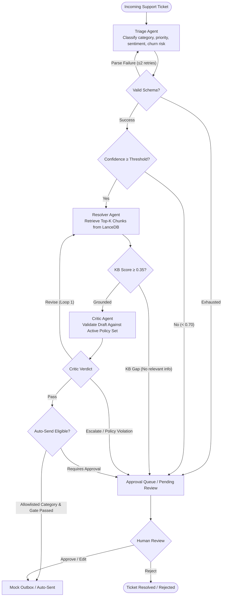

# Support Triage Agent

[](https://www.python.org/downloads/)
[](https://fastapi.tiangolo.com)
[](https://github.com/langchain-ai/langgraph)
[](https://react.dev/)
[](https://ollama.com)
[](https://ai.google.dev/)

> **"Most agent demos stop at 'the LLM replied.' This one triages customer tickets through a multi-agent graph with guardrails, pauses for human approval when policy demands it, traces every decision, and refuses to automate at all until its eval metrics clear a gate."**

A production-grade, domain-agnostic multi-agent support desk with built-in trust machinery: compliance guardrails, human-in-the-loop (HITL) approval queues, first-party observability, and an offline evaluation gate. Demonstrated with **ShopLite**, a fictional e-commerce store.

---

## 1. Product Vision & Differentiators

Customer support automation often fails in production because models hallucinate, offer unauthorized refunds, or breach company policies. Support Triage Agent solves this by embedding **trust machinery** directly into the agent architecture:

* **Multi-Agent State Graph**: Tickets move through specialized agents (**Triage** → **Resolver** → **Critic**) governed by typed transitions and state checkpoints.
* **Compliance Guardrails & Critic**: Every drafted reply is verified by a dedicated Critic agent against a versioned policy set before it can ever be sent.
* **Human-in-the-Loop (HITL) by Default**: Automation is gated. If confidence is low, knowledge is missing, or policy requires escalation, LangGraph interrupts execution and routes the draft to a human approval queue.
* **Evaluation Gate**: The `auto_send` master switch remains **disabled** until the system passes an automated evaluation gate against a versioned golden ticket dataset.
* **Plug-and-Play Principle**: The agent engine is strictly domain-agnostic. Everything specific to ShopLite lives in three swappable data artifacts:
  1. **Knowledge Base** (`data/kb/*.md`) — Markdown support articles indexed into a vector store.
  2. **Policy Set** (`policies/*.yaml`) — Versioned guardrail rules (refund limits, SLA promises, escalation rules).
  3. **Taxonomy** (`configs/taxonomy.yaml`) — Category classifications, priority levels, confidence thresholds, and auto-send allowlists.

Swapping these three artifacts onboards an entirely new business (fintech, healthcare, internal IT) with **zero code changes**.

---

## 2. Agent Graph Architecture

The core engine is structured as a LangGraph `StateGraph` backed by a SQLite checkpointer with persistent thread state:



### Key Engineering Invariants
* **LLM Call Budget**: Hard cap of **$\le$6 calls per ticket** enforced in state (Triage 1 + $\le$2 retries; Resolver 1 + $\le$1 revision; Critic 1 + $\le$1 recheck).
* **Decoupled Provider Layer**: LangGraph agent nodes invoke our domain `BaseLLM` interface, never vendor SDKs directly.
* **First-Party Tracing**: Every node execution records duration, model, prompt version, retry counts, and token consumption to an SQLite trace store.

---

## 3. Technology Stack

| Layer | Technology | Rationale |
|---|---|---|
| **Backend API** | Python 3.11, FastAPI, Uvicorn | High-performance asynchronous REST API, auto-generated OpenAPI 3.1 spec. |
| **Agent Orchestration** | LangGraph, SQLite Checkpointer | State machine with durable checkpoints, interrupts for human approval, and conditional branching. |
| **Provider Abstraction** | Ollama (default local), Google Gemini, AWS Bedrock (stub) | Swappable via one YAML configuration line without engine code modifications. |
| **Vector Store** | LanceDB | Embedded, zero-infra serverless vector database for knowledge base embeddings. |
| **Application Database** | SQLite via SQLAlchemy 2.0 | Zero-infrastructure local persistence for tickets, drafts, outbox messages, and node execution traces. |
| **Frontend UI** | React 18, Vite, TypeScript (strict), Tailwind CSS | Fast SPA with typed client, real-time polling, and responsive status views. |
| **Server State & Networking** | TanStack Query (`@tanstack/react-query`) | Declarative caching, automatic 10 s polling, and graceful offline error recovery. |
| **Contract & Types** | `openapi-typescript` | Zero schema drift: TypeScript types are compiled directly from FastAPI's OpenAPI JSON. |
| **Package Management** | `uv` (Python), `npm` (Node.js) | High-speed dependency resolution and deterministic virtual environments. |

---

## 4. Repository Structure

```
support-triage-app/
├── PROJECT_SPEC.md                 # System requirements, contracts & invariants
├── configs/                        # Runtime configurations (tunables & taxonomy)
│   ├── app.yaml                    # Active provider, thresholds, call budgets, master switches
│   ├── taxonomy.yaml               # Category rules, priorities, routing, auto-send allowlist
│   ├── evals.yaml                  # Evaluation thresholds and golden set configurations
│   └── providers/                  # Provider profiles (ollama.yaml, gemini.yaml, bedrock.yaml)
├── backend/
│   ├── pyproject.toml              # Python dependencies managed via uv
│   ├── app/
│   │   ├── main.py                 # FastAPI application factory, CORS, lifespan
│   │   ├── core/                   # config.py (Pydantic Settings), logging.py, errors.py
│   │   ├── api/routes/             # health.py, tickets.py, approvals.py, kb.py, evals.py
│   │   ├── models/                 # Pydantic schemas (the API contract)
│   │   ├── db/                     # SQLAlchemy models, session factory, enums
│   │   ├── agents/                 # LangGraph StateGraph, state schemas, node definitions
│   │   └── services/               # Provider abstraction, KB pipeline, tracing, evals
│   ├── prompts/                    # Versioned prompt templates (YAML)
│   ├── policies/                   # Versioned compliance guardrail rules (YAML)
│   ├── data/                       # Committed fixtures and markdown KB articles
│   ├── scripts/                    # smoke_test.py, seed_kb.py, simulate_tickets.py
│   └── tests/                      # fakes.py, unit tests, integration tests
├── frontend/
│   ├── package.json                # React/Vite dependencies
│   ├── vite.config.ts              # Reverse proxy configuration
│   └── src/
│       ├── api/                    # schema.d.ts (auto-generated) + client.ts
│       ├── components/             # Reusable UI components & Navbar
│       └── pages/                  # Health, Inbox, TicketDetail, ApprovalQueue, EvalLab
└── docs/
    └── architecture/               # Architecture Decision Records (ADRs)
```

---

## 5. Getting Started

### Prerequisites
* **Python 3.11.x**
* **Node.js 20+ LTS**
* **uv** (`pip install uv` or via standalone installer)
* **Ollama** installed with models pulled:
  ```bash
  ollama pull llama3.2:latest
  ollama pull nomic-embed-text
  ```

---

### Backend Setup

1. Navigate to the backend directory:
   ```bash
   cd backend
   ```

2. Sync dependencies using `uv`:
   ```bash
   uv sync
   ```

3. Run the provider smoke test to verify local inference:
   ```bash
   .venv\Scripts\python scripts/smoke_test.py       # Windows
   # or: .venv/bin/python scripts/smoke_test.py    # macOS / Linux
   ```

4. Run the automated test suite:
   ```bash
   .venv\Scripts\python -m pytest tests/ -v
   ```

5. Launch the FastAPI development server:
   ```bash
   .venv\Scripts\uvicorn app.main:app --reload --port 8000
   ```
   * Interactive API docs: [http://127.0.0.1:8000/docs](http://127.0.0.1:8000/docs)
   * System health check: [http://127.0.0.1:8000/api/health](http://127.0.0.1:8000/api/health)

---

### Frontend Setup

1. Open a new terminal and navigate to the frontend directory:
   ```bash
   cd frontend
   ```

2. Install dependencies:
   ```bash
   npm install
   ```

3. (Optional) Regenerate TypeScript types from the running backend:
   ```bash
   npm run gen:api
   ```

4. Start the Vite development server:
   ```bash
   npm run dev
   ```
   * Web application: [http://localhost:5173](http://localhost:5173)

---

## 6. Swapping LLM Providers (Zero Code Changes)

The system is configured via `backend/configs/app.yaml`. To switch from local Ollama to Google Gemini:

1. Add your Google API key to `.env` (copy from `.env.example`):
   ```env
   GOOGLE_API_KEY=your_actual_key_here
   ```
2. Edit `backend/configs/app.yaml`:
   ```yaml
   # Change:
   provider: gemini
   ```
3. Restart or reload the backend. The provider factory automatically initializes `GeminiLLM` (`gemini-2.0-flash`) and `GeminiEmbedder` (`text-embedding-004`).

---

## 7. Architectural Decisions

Key design choices are documented as formal Architecture Decision Records:
* [ADR-001: Monorepo Structure for Full-Stack Agent Application](docs/architecture/decisions.md#adr-001-monorepo-structure-for-full-stack-agent-application)
* [ADR-002: Provider Abstraction Decoupled from Orchestration Framework](docs/architecture/decisions.md#adr-002-provider-abstraction-decoupled-from-orchestration-framework)
* [ADR-003: SQLite via SQLAlchemy 2.0 as Primary Application Database](docs/architecture/decisions.md#adr-003-sqlite-via-sqlalchemy-20-as-primary-application-database)
* [ADR-004: OpenAPI-Generated TypeScript Client via openapi-typescript](docs/architecture/decisions.md#adr-004-openapi-generated-typescript-client-via-openapi-typescript)
