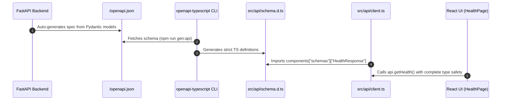
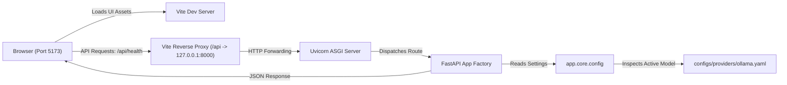

# Phase 1 — Foundations: Monorepo Scaffold, Provider Abstraction & Typed Health Interface

This document covers the foundational architecture established in Phase 1 of the **Support Triage Agent** system. It details the rationale, tradeoffs, and design choices behind the monorepo layout, the provider abstraction layer, schema-driven frontend typing, and query lifecycle management.

---

## 1. Concepts & Architecture

### 1.1 Monorepo vs. Polyrepo for Agentic AI Systems

Our application consists of two interdependent packages: a Python backend (`FastAPI`, `LangGraph`, `SQLAlchemy`) and a TypeScript frontend (`React 18`, `Vite`, `Tailwind`, `TanStack Query`).

```
support-triage-app/
├── backend/       # Python 3.11 + uv packaging
├── frontend/      # Node 20+ + npm packaging
├── docs/          # Architecture decisions, learning logs, interview questions
└── configs/       # Runtime YAML configurations & domain taxonomy
```

#### Why a Monorepo?
1. **Single Point of Evolution for the Contract**: In an agentic application, the backend API contract changes rapidly as new agent states, telemetry spans, and guardrail violations are introduced. A monorepo allows atomic commits where an OpenAPI schema update and the corresponding frontend UI adjustments land together in git history.
2. **Simplified CI/CD & Local Development**: Developers clone one repository, execute `uv sync` for the engine and `npm install` for the UI, and run both servers concurrently without orchestrating git submodules or internal npm registry publishing.
3. **Traceability**: Architecture decision records (ADRs), golden evaluation datasets, and run instructions reside alongside the code they govern.

#### Tradeoffs Accepted:
- **Tooling Divergence**: Python uses `uv` while the frontend uses `npm`. We avoid trying to force a unified JavaScript or Python task runner (like Nx or Pants) across both languages, maintaining native toolchains for each ecosystem.

---

### 1.2 The Provider Abstraction (Strategy + Factory)

A common mistake in agentic engineering is allowing orchestration frameworks (like LangChain or LangGraph) to invoke LLM providers directly via third-party integration libraries (e.g., `langchain-community`, `langchain-openai`). This tightly couples the agent execution graph to vendor-specific SDK semantics, obscuring token budgeting, timeout policies, and retry mechanics.

In our architecture, **LangGraph sits ABOVE our provider abstraction, not inside it**:

```mermaid
flowchart TD
    Config["configs/app.yaml\n(provider: ollama | gemini | bedrock)"] --> Factory["app.services.providers.factory\nget_providers()"]
    Factory -->|instantiates| BaseLLM["BaseLLM\n(Abstract Base Class)"]
    Factory -->|instantiates| BaseEmbedder["BaseEmbedder\n(Abstract Base Class)"]

    BaseLLM -->|Concrete Implementation| OllamaLLM["OllamaLLM\n(Local llama3.2:latest via HTTP)"]
    BaseLLM -->|Concrete Implementation| GeminiLLM["GeminiLLM\n(Google GenAI SDK gemini-2.0-flash)"]
    BaseLLM -->|Concrete Implementation| BedrockLLM["BedrockLLM\n(AWS Bedrock Claude Haiku stub)"]

    subgraph Agentic Layer [LangGraph State Machine (Phases 3-4)]
        TriageNode["Triage Node"] -->|calls .generate()| BaseLLM
        ResolverNode["Resolver Node"] -->|calls .generate()| BaseLLM
        CriticNode["Critic Node"] -->|calls .generate()| BaseLLM
    end
```

#### Strategy Pattern (`BaseLLM`, `BaseEmbedder`)
- `BaseLLM.generate(messages, **kwargs) -> LLMResponse`: Normalizes message inputs across providers (`system`, `user`, `assistant`) and guarantees a structured return (`text`, `model_name`, `prompt_tokens`, `completion_tokens`, `total_tokens`, `latency_ms`).
- `BaseEmbedder.embed_documents(texts)` & `embed_query(text)`: Guarantees standardized vector dimensions (`dimension: int`), abstracting whether vectors come from local `nomic-embed-text` or cloud `text-embedding-004`.

#### Factory Pattern (`factory.py`)
- Reads `configs/app.yaml` at runtime.
- Instantiates the active provider using dedicated configuration models (`LLMConfig`, `EmbedderConfig`).
- Changing providers from local zero-cost Ollama to Google Gemini requires editing **one YAML line** (`provider: gemini`), requiring zero changes to engine or graph code.

#### Centralized Retries and Backoff (`tenacity`)
Retries for transient infrastructure failures (HTTP timeouts, connection drops, rate limits) belong strictly in the `BaseLLM._generate_with_retry` template method:
- **3 attempts** with exponential backoff ($1\text{ s} \to 2\text{ s} \to 4\text{ s}$, max $10\text{ s}$).
- Catches `ProviderTimeoutError`, `ProviderRateLimitError`, and `ProviderUnavailableError`.
- **Deliberate Separation**: Application-level semantic failures (such as malformed JSON from an LLM in a structured output node) are **not** retried by `BaseLLM`. They are propagated up to the agent node, which feeds the parse error back to the model in a prompt revision loop. Infrastructure retries and agent semantic retries operate on completely distinct layers.

---

### 1.3 OpenAPI Type Generation: Zero Schema Drift

Manual duplication of backend interfaces in TypeScript files (`interface HealthResponse { ... }`) is a primary source of subtle full-stack bugs. When a backend engineer renames a field (e.g., `model` to `chat_model`), frontend code continues to compile until runtime errors emerge in production.

We eliminate this via automated schema generation using `openapi-typescript`:



- Backend single source of truth: Pydantic models in `app/models/` and route return annotations define the schema.
- When the API changes, running `npm run gen:api` immediately updates `schema.d.ts`. Any component relying on deprecated or modified properties fails TypeScript compilation instantly during `npm run build`.

---

### 1.4 TanStack Query: Server State vs. Client State

Traditional React patterns frequently misuse `useState` and `useEffect` to fetch and store remote data. This conflates **server state** (remote data owned by the backend, asynchronous, shared across clients) with **client state** (UI-specific state like modals, tabs, or input buffers).

`TanStack Query` (`@tanstack/react-query`) treats server state as a cache with declarative lifecycle management:
- **Polling / Freshness**: `refetchInterval: 10_000` automatically polls `/api/health` every 10 seconds without custom `setInterval` cleanup boilerplate.
- **Graceful Failure States**: Network errors, 500s, or backend restarts trigger `isError` and provide structured `error` objects without leaving a blank screen or crashing the component tree.
- **Deduplication & Window Refocus**: Multiple components requesting system health reuse the same cache entry, automatically revalidating when the operator re-focuses the browser tab.

---

### 1.5 System Request Flow



---

## 2. Business Relevance & Cost Modeling

1. **Zero-Dollar Local Development**: By selecting `Ollama` (`llama3.2:latest` chat + `nomic-embed-text` embeddings) as the default provider, developers and automated CI pipelines run the full agent suite with zero operational API expense.
2. **Vendor Lock-in Immunity**: Commercial platforms often build directly on proprietary SDKs (e.g., Azure OpenAI or AWS Bedrock specific tools). If enterprise pricing changes or a model is deprecated, migrating requires rewriting prompt dispatch logic. Our `BaseLLM` interface insulates core business logic; switching vendors is a single configuration line.
3. **Auditability & Cost Governance**: Standardizing `LLMResponse` ensures every inference call returns measured token counts and exact round-trip latencies, which feeds directly into the per-node SQLite trace store implemented in Phase 5.
